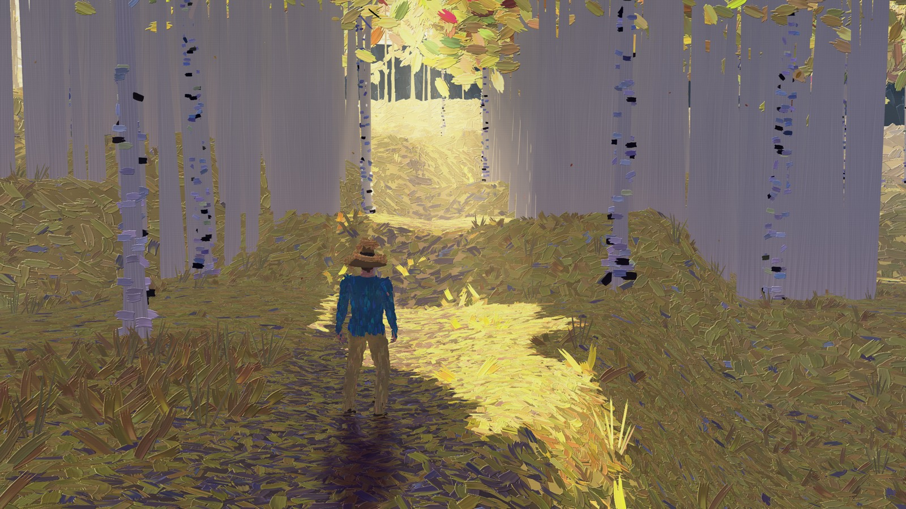
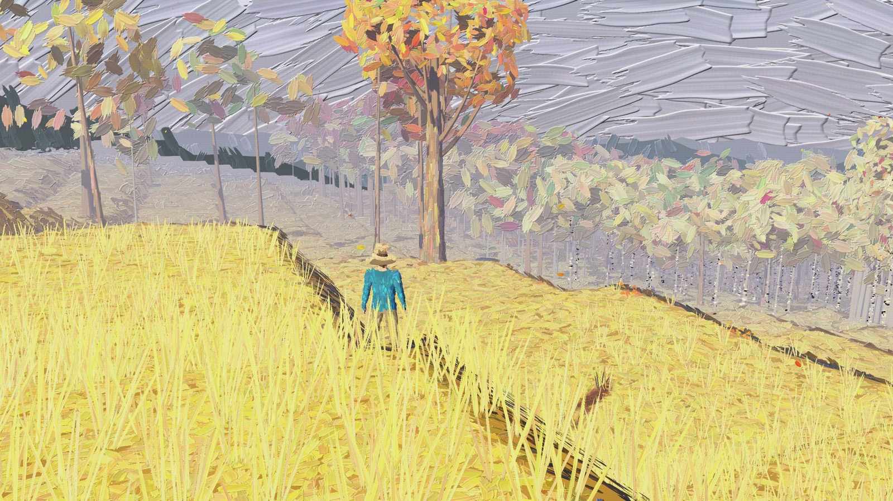

# oil-forest — 화담숲 가을 인상을 유화 붓 자국으로 걷는 장면

경기도 광주 화담숲에서 받은 가을 인상을 three.js 유화 렌더러로 그린 걷기 장면입니다. 잎 · 줄기 · 땅 · 등산객 옷까지 모두 세계에 고정된 붓 자국 하나하나로 그려지므로, 걸어도 물감이 사물에 붙어 있습니다. 실제 장소를 그대로 옮기지 않고, 실제 고도로 만든 땅과 지평선 위에 인상을 칠합니다.

화담숲 운영 측과 관계없는 개인 작업입니다. 공식 사진 · 로고 · 지도 배치는 쓰지 않았습니다.


## 실행 — 개발 서버 · 빌드

```sh
npm install
npm run dev     # http://127.0.0.1:5406/?scene=hwadam
npm run build   # dist/ 에 정적 파일
npm run serve   # http://127.0.0.1:5405/?scene=hwadam
```

화면을 클릭한 뒤 마우스로 둘러보고, WASD 로 걷고, Shift 로 달리고, Space 로 뜁니다. 휠은 시점 거리를 바꾸고 H 는 도움말을 숨깁니다. 오른쪽 위 버튼 Aurora · Autumn wood 는 원본 장면이고, Hwadam walk 가 이 레포의 장면입니다. WebGL2 가 되는 데스크톱 브라우저가 필요합니다.

## 장면 구성 — 길 위 구간 넷

길은 이끼원 → 단풍 오르막 → 자작나무숲 → 능선 전망 순서로 이어집니다. 길 위 위치 하나(`t`)가 지금 어느 구간인지 정하고, 나무 종류 · 바닥 색 · 안개가 그 값을 따라 섞입니다. 코드는 `src/hwadam/` 에 있습니다.



## 지형 — 실제 고도 · 실제 지평선

- 기준점은 OpenStreetMap 의 화담숲 영역(way 486063098) 한 점입니다. © OpenStreetMap contributors, ODbL.
- 고도는 AWS Terrain Tiles(terrarium)에서 받습니다. `tools/fetch-dem.mjs` 가 타일마다 원자료 헤더를 확인해 SRTM · GMTED2010 이 아니면 멈춥니다.
- 발밑 땅은 512 m 사방을 2 m 간격으로(`near.bin`), 먼 지평선은 방위 360개 × 거리 띠 셋(2 · 5 · 15 km)으로(`horizon.bin`) 굽습니다.
- 걷는 길은 `tools/make-way.mjs` 가 고도에서 최소 비용 경로로 만든 591 m 입니다. 실제 산책로 배치가 아닙니다.
- 능선 전망 구간은 산줄기가 세 겹 보이는 방위(112° · 143°, `tools/horizon-layers.mjs` 로 계산) 쪽으로 시선이 트이도록 앞 나무를 비웁니다.

Global GMTED2010 and SRTM terrain data courtesy of the U.S. Geological Survey.



## 바탕 — Patch 의 oil-paint (MIT)

이 레포는 Patch 의 [oil-paint](https://patch.gg/blendi/oil-paint)(커밋 `804c65f`)를 바탕으로 합니다. 렌더러 `src/oilpaint/` 는 원본 그대로이고, 원본 설명은 [OIL-PAINT.md](OIL-PAINT.md) 에 있습니다. 라이선스가 따로 적혀 있지 않은 `lib/patch-block.js` 는 넣지 않고 `lib/block-shim.js` 로 대신합니다. 등산객은 Patch 의 starter man(MakeHuman · Quaternius, CC0)에 옷 색과 밀짚모자를 입힌 것입니다.

## 진행 상황 — 화면만 보는 비평 관문

그림을 바꾼 묶음은 화면만 보는 새 비평가가 심각도(치명 · 큼 · 보통 · 사소함)를 매기고, 치명 · 큼이 0개여야 통과합니다. 라운드는 묶음마다 다섯 번까지입니다. 마일스톤 2(실제 지형 · 등산객)는 다섯 라운드를 마치고 "진행 중"으로 남아 있습니다. 라운드별 지적과 결정은 [PLAN.md](PLAN.md) 에 있습니다.

## 라이선스 — 코드 MIT · 그림 CC0

코드는 MIT([LICENSE](LICENSE))입니다. 부분별 출처와 라이선스는 [LICENCE-NOTES.md](LICENCE-NOTES.md) 에 있습니다.
